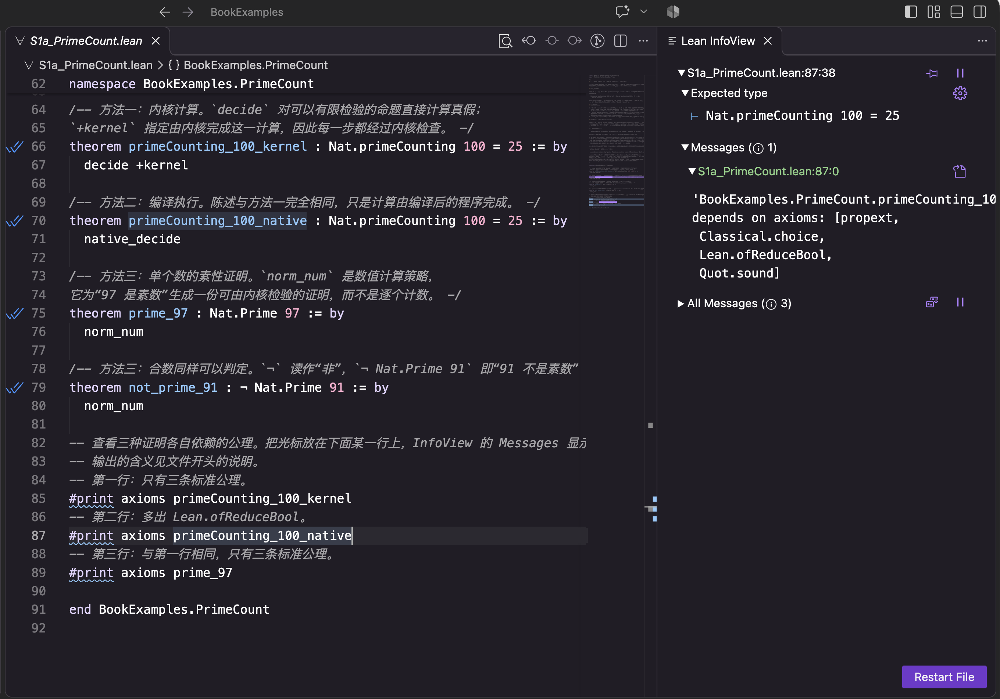
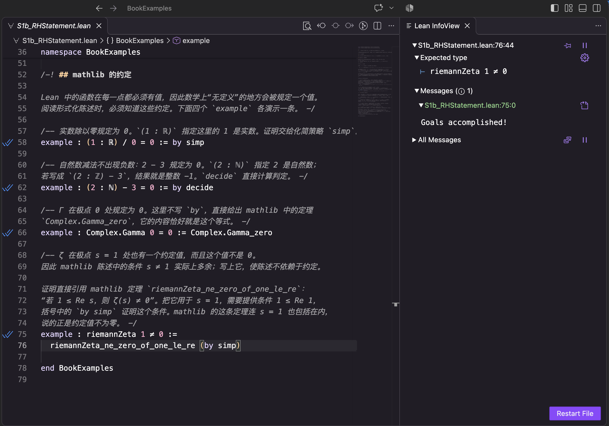
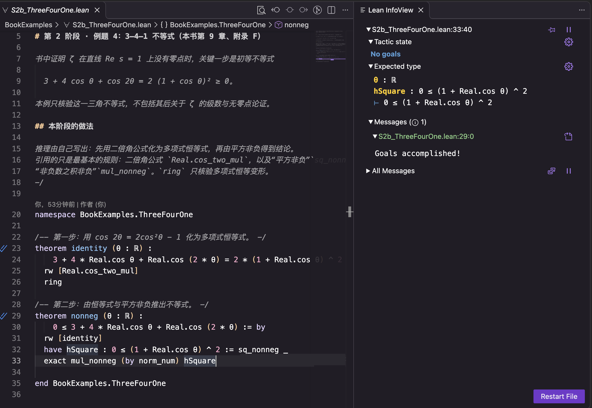
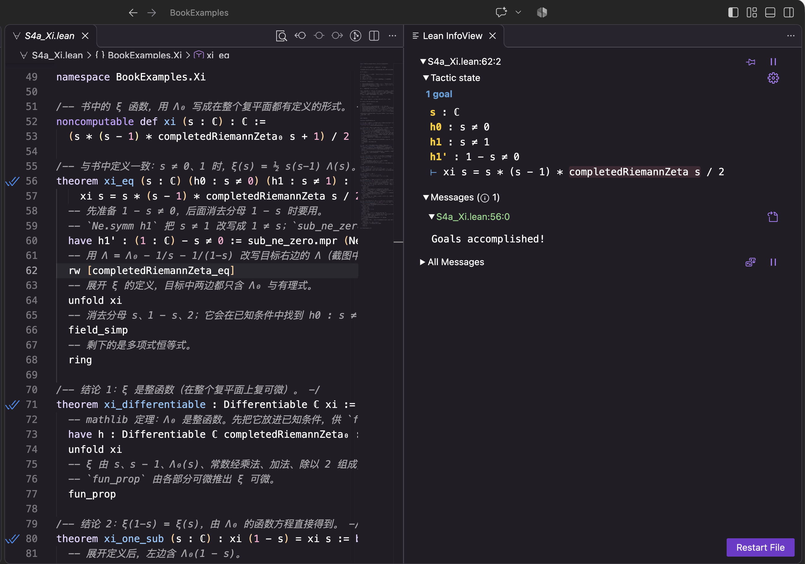
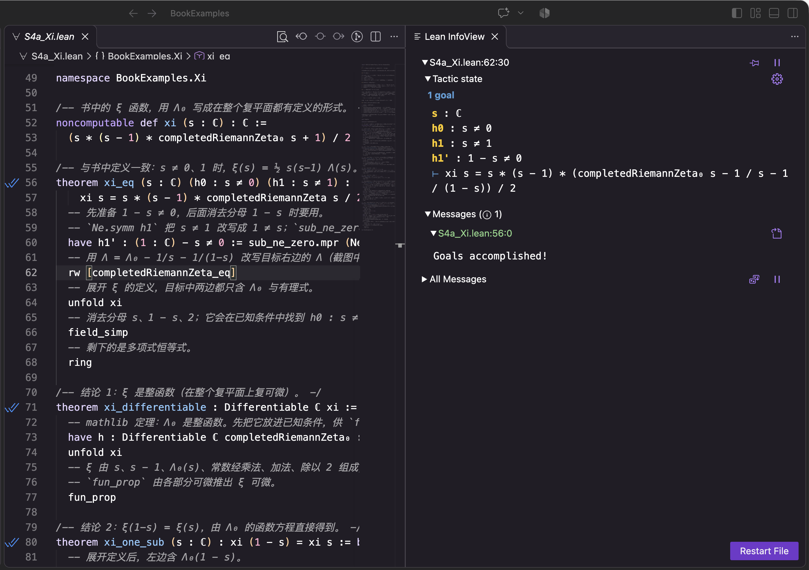
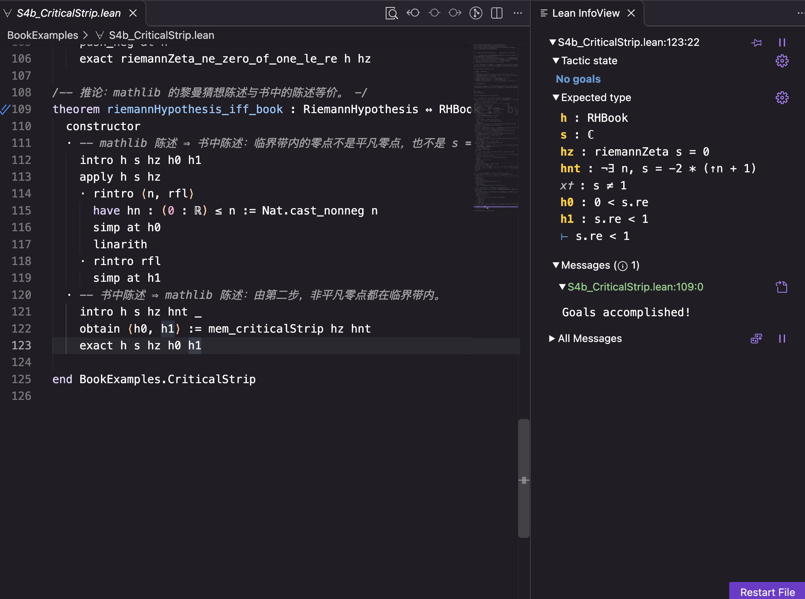
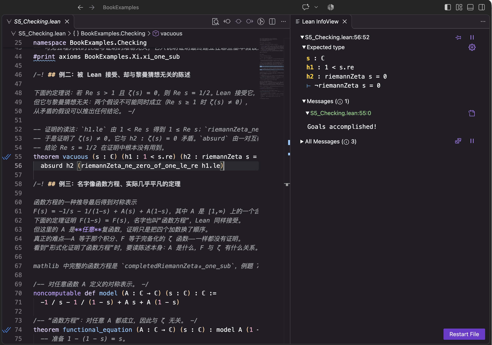

# 命题的形式化验证（Lean 4）

本栏目借本书读者已经熟悉的数学内容，介绍一种不同的数学证明方法——**形式化证明**：把定义、命题和每一步推理写成严格的形式语言，由计算机逐步检查。

本栏目不是 Lean 教程，而是从本书中选取若干命题，把它们的陈述与证明写成形式化代码，由 Lean 逐步检查。全部例题按“自己写多少、借用数学库多少”分为四个阶段，最后一节说明怎样检查一个号称“已经形式化”的证明。随着 AI 生成的数学证明越来越多，这种检查能力会越来越常用。

系统学习 Lean，请阅读下文推荐的教材。

## Lean 与 mathlib

[Lean](https://lean-lang.org/) 是一种证明助手，本栏目使用 Lean 4。[mathlib](https://github.com/leanprover-community/mathlib4) 是 Lean 社区共同维护的数学库，其中每条定理都有完整的形式化证明，并经 Lean 检查。引用 mathlib 的定理，相当于写论文时引用已发表的引理：省去重复的工作，检查的标准并不降低。

引用 mathlib 有两种方式：

| | 含义 | 例子 |
|---|---|---|
| **显式引用** | 在证明中点名使用某条库定理 | `rw [completedRiemannZeta_eq]` |
| **隐式引用** | 不写定理名，由自动化策略在幕后调用库中的引理；实数、复数、ζ 等定义本身也来自 mathlib | `ring`、`simp`、`field_simp`、`norm_num` |

两种引用同样可靠，最终都追溯到 Lean 的基本公理；区别只在于读者能否直接看到用了哪些已知结果。用 `simp?` 可以列出 `simp` 实际调用的引理，把隐式引用变成显式。

## 四个阶段与八道例题

| 阶段 | 例题 | 本书出处 | 要点 |
|---|---|---|---|
| **1 认识形式化陈述** | [π(100) = 25 的三种核验](BookExamples/S1a_PrimeCount.lean) | 第 1、2 章 | 内核计算与编译执行的信任范围不同 |
| | [黎曼猜想的 Lean 陈述](BookExamples/S1b_RHStatement.lean) | 第 11 章 | 读懂形式化陈述；mathlib 的约定值 |
| **2 推理自己写** | [有限 Abel 分部求和公式](BookExamples/S2a_AbelSummation.lean) | 附录 B | 归纳法；只用最基本的运算规则 |
| | [3–4–1 不等式](BookExamples/S2b_ThreeFourOne.lean) | 第 9 章、附录 F | 三角恒等式与非负性 |
| **3 部分显式引用** | [von Mangoldt 恒等式与 Möbius 反演](BookExamples/S3a_VonMangoldt.lean) | 第 2 章、附录 A | 引用一般结果，主线自己推 |
| | [Chebyshev 上界 θ(n) ≤ n log 4](BookExamples/S3b_Chebyshev.lean) | 第 2 章 | 引用组合估计，分析步骤自己写 |
| **4 全部显式引用** | [ξ 函数](BookExamples/S4a_Xi.lean)：整函数、对称、ξ(0)=ξ(1)=½、临界带内零点与 ζ 一致 | 第 10 章 | 库的约定迫使改用 Λ₀ 定义 ξ |
| | [非平凡零点位于开临界带](BookExamples/S4b_CriticalStrip.lean)，并证明两种黎曼猜想陈述等价 | 第 9–11 章 | 由函数方程拼接三块已知结果 |
| **收尾** | [怎样检查一个形式化证明](BookExamples/S5_Checking.lean) | 综合 | 证明是否完整、依赖哪些公理、陈述是否忠实 |

第 2 阶段的“推理自己写”指：不引用 mathlib 中关于所论对象（素数、ζ、Γ 等）的定理，只用最基本的运算规则（如有限和拆出最后一项、二倍角公式）和自动化策略。

每道例题的文件开头列出：书中的结论、mathlib 中的对应对象、显式引用的库定理，以及形式化陈述与书中表述在记号、条件和约定上的差别。不安装 Lean 也可以在 GitHub 上直接阅读。

## 附表：本书其他命题在 mathlib 中的对应

[A_LibraryMap.lean](BookExamples/A_LibraryMap.lean) 把书中另外一些结论与 mathlib 已有的定理逐条对照：先用 Lean 写出书中的陈述，再直接引用库定理完成证明。它不属于四个阶段，供查阅。

| 本书出处 | 结论 | mathlib 定理 |
|---|---|---|
| 第 2 章、附录 A | ∑_{d∣n} μ(d) = [n = 1]；Möbius 反演 | `coe_moebius_mul_coe_zeta`、`sum_eq_iff_sum_smul_moebius_eq` |
| 附录 B | Abel 求和公式（积分形式） | `sum_mul_eq_sub_integral_mul` |
| 第 5 章 | Euler 乘积（Re s > 1） | `riemannZeta_eulerProduct_tprod` |
| 第 7 章 | Γ 的倍元公式、余元公式 | `Complex.Gamma_mul_Gamma_add_half`、`Complex.Gamma_mul_Gamma_one_sub` |
| 第 9 章 | 函数方程；Re s ≥ 1 时 ζ(s) ≠ 0；ζ(1) 的约定值 | `riemannZeta_one_sub`、`riemannZeta_ne_zero_of_one_le_re`、`riemannZeta_one` |
| — | ζ(2) = π²/6；ζ(−1) = −1/12 | `riemannZeta_two`；后者由 `riemannZeta_neg_nat_eq_bernoulli'` 补写 |

## 学习笔记配套例程

以下两例对应配套学习笔记，不是本书正文的命题，放在 [NotesExamples](NotesExamples/) 中，同样经自动检查：

| 文件 | 内容 | 对应 |
|---|---|---|
| [ShiftStableSum.lean](NotesExamples/ShiftStableSum.lean) | 对全部实数序列要求“首项分离”求和规则会产生矛盾 | 学习笔记第 11 篇 |
| [Mersenne61.lean](NotesExamples/Mersenne61.lean) | 以 Lucas–Lehmer 计算证书核验 2^61 − 1 的素性 | 学习笔记第 16 篇 |

## 在 VS Code 中看到的证明状态

Lean 的 VS Code 插件在编辑器右侧显示 InfoView：光标所在位置的假设与待证目标（Tactic state）、定理的检查结果（Messages）。以下截图取自作者本机，Lean 与 mathlib 版本与本目录相同。

**例题 1：两种证明依赖的公理不同。** 光标在 `#print axioms primeCounting_100_native` 上，右侧列出的公理中多出 `Lean.ofReduceBool`。



**例题 2：约定值。** 光标在 ζ(1) ≠ 0 的证明上，右侧显示待证命题 `riemannZeta 1 ≠ 0`。



**例题 4：3–4–1 不等式的最后一步。** 右侧列出已得到的 `hSquare : 0 ≤ (1 + cos θ)²`，与待证目标相同。



**例题 7：用 Λ₀ 改写 Λ。** 第一张是改写之前，目标中是 `completedRiemannZeta s`（即 Λ）；第二张是执行 `rw [completedRiemannZeta_eq]` 之后，Λ 已换成 `completedRiemannZeta₀ s - 1 / s - 1 / (1 - s)`。上方列出的 s ≠ 0、s ≠ 1、1 − s ≠ 0 是随后化简所需的条件。





**例题 8：由书中陈述推出 mathlib 陈述。** 右侧列出 `h : RHBook`、ζ(s) = 0、s 不是平凡零点，以及由临界带结论得到的 0 < Re s、Re s < 1；最后一步只需把这些交给 `h`。



**收尾：互相矛盾的假设。** 右侧同时列出 `h1 : 1 < s.re` 与 `h2 : riemannZeta s = 0`。两者不可能同时成立，所以结论 Re s = 1/2 虽被 Lean 接受，却说明不了任何问题。



## 自动检查

仓库配置了自动检查：本目录的文件更新后，GitHub 服务器用固定版本的 Lean 与 mathlib 构建全部例题。构建时任何警告都按错误处理；含 `sorry` 的证明会产生警告，因此通不过检查。检查还确认文件中没有用 `axiom` 声明新的公理。检查通过，表示例题中的形式化证明已被 Lean 接受，其中不含 `sorry`，也未添加新的公理；各例实际依赖哪些公理，可用 `#print axioms` 查看（见例题 1 与收尾一节）。检查记录在仓库的 Actions 页面公开。

Lean 只检查推导，不检查形式化陈述是否忠实于书中原意；这一点须由读者对照判断，见收尾一节。

## 推荐教材

以下为 Lean 社区推荐的正式教材与入门材料（英文，均可免费在线阅读）：

| 教材 | 特点 |
|---|---|
| [Mathematics in Lean](https://leanprover-community.github.io/mathematics_in_lean/) | 面向数学工作者的标准教材，以 mathlib 为基础，附练习 |
| [The Mechanics of Proof](https://hrmacbeth.github.io/math2001/) | 节奏较缓，适合数学证明经验较少的读者 |
| [Theorem Proving in Lean 4](https://lean-lang.org/theorem_proving_in_lean4/) | 讲解 Lean 的类型论基础，适合想了解证明助手原理的读者 |
| [Natural Number Game](https://adam.math.hhu.de/#/g/hhu-adam/NNG4) | 浏览器中的交互入门，无需安装 |
| [mathlib 文档](https://leanprover-community.github.io/mathlib4_docs/) | 按名称查找定理及其陈述 |

更多资源见 Lean 社区的 [学习页面](https://leanprover-community.github.io/learn)。

## 在本机运行（可选）

安装 Lean 后，在本目录执行：

```bash
lake exe cache get   # 下载 mathlib 的预编译文件
lake build           # 构建并检查全部例题
```

本目录固定的版本：Lean `v4.22.0-rc4`，mathlib 提交 `e20d25f`（2025-08-06）。
