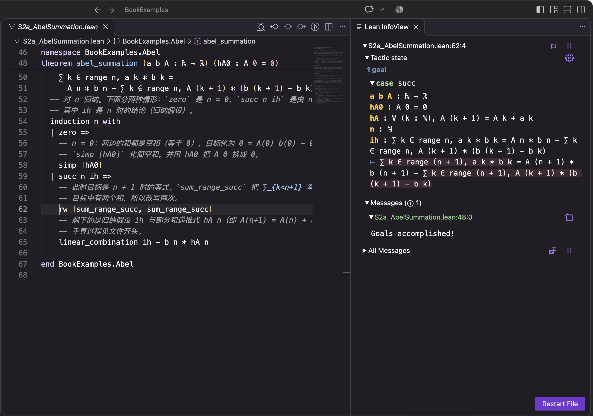
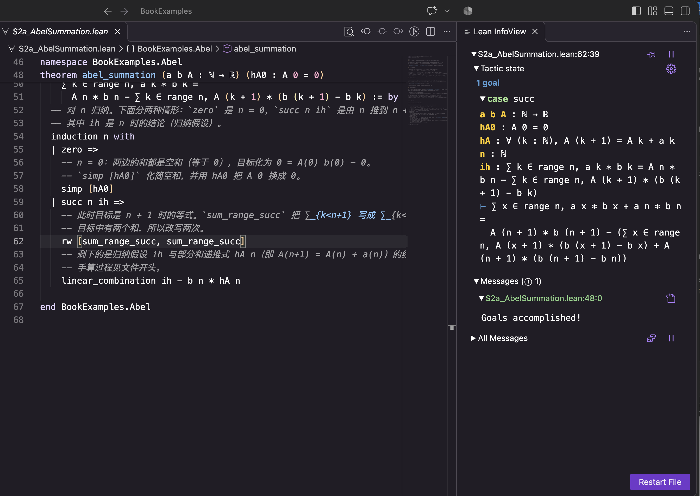
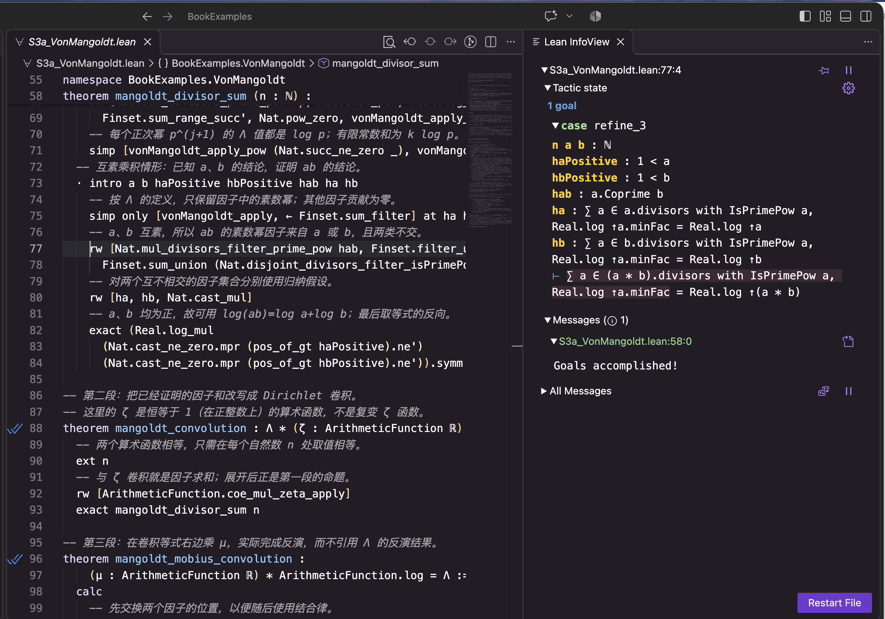
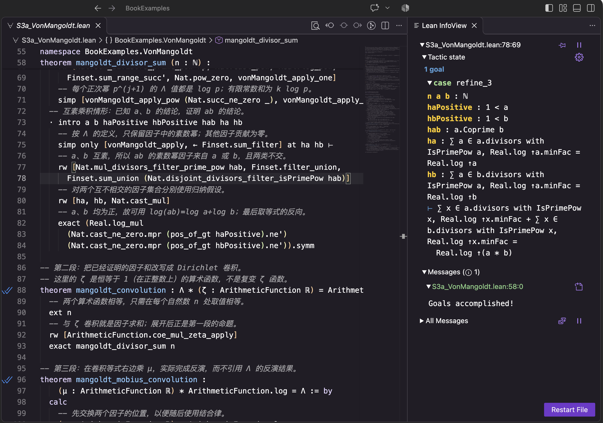
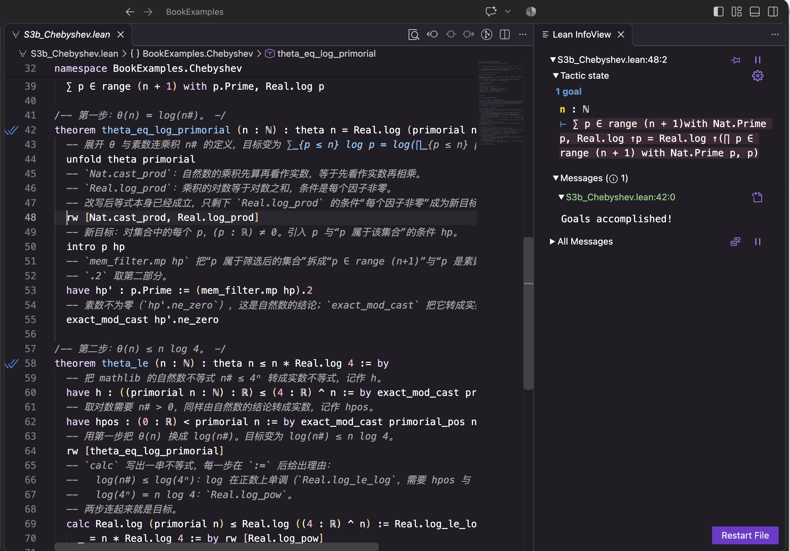
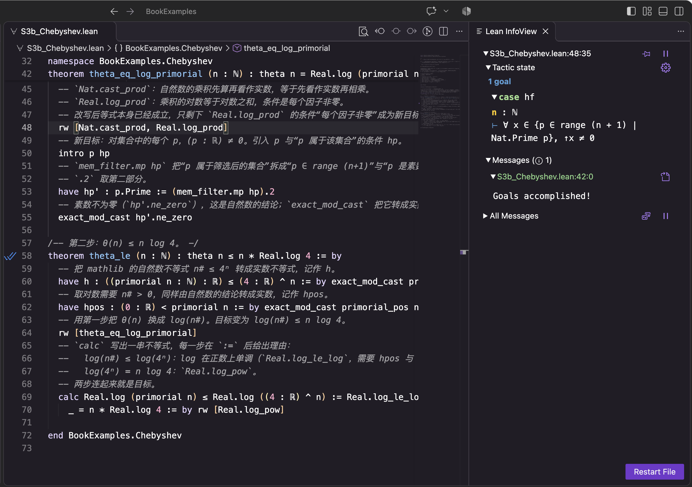

# 命题的形式化验证（Lean 4）

本栏目借本书读者已经熟悉的数学内容，介绍一种不同的数学证明方法——**形式化证明**：把定义、命题和每一步推理写成严格的形式语言，由计算机逐步检查。

本栏目不是 Lean 教程，而是从本书中选取若干命题，把它们的陈述与证明写成形式化代码，由 Lean 逐步检查。全部例题按“自己写多少、借用数学库多少”分为四个阶段，最后一节说明怎样检查一个号称“已经形式化”的证明。随着 AI 生成的数学证明越来越多，这种检查能力会越来越常用。

系统学习 Lean，请阅读下文推荐的教材。

## Lean 与 mathlib

[Lean](https://lean-lang.org/) 是一种证明助手，本栏目使用 Lean 4。[mathlib](https://github.com/leanprover-community/mathlib4) 是 Lean 社区共同维护的数学库，其中每条定理都有完整的形式化证明，并经 Lean 检查。引用 mathlib 的定理，相当于写论文时引用已发表的引理：省去重复的工作，检查的标准并不降低。

引用 mathlib 有两种方式：

| | 含义 | 例子 |
|---|---|---|
| **显式引用** | 在证明中点名使用某条库定理 | `rw [completedRiemannZeta_eq]` |
| **隐式引用** | 不写定理名，由自动化策略在幕后调用库中的引理；实数、复数、ζ 等定义本身也来自 mathlib | `ring`、`simp`、`field_simp`、`norm_num` |

两种引用同样可靠，最终都追溯到 Lean 的基本公理；区别只在于读者能否直接看到用了哪些已知结果。用 `simp?` 可以列出 `simp` 实际调用的引理，把隐式引用变成显式。

## 读懂 Lean 代码与 InfoView

初次接触 Lean 的读者，可以先读本节，再读例题。这里只解释本栏目用到的写法；系统学习请读下文推荐的教材。

### 一条定理的写法

```lean
theorem nonneg (θ : ℝ) :
    0 ≤ 3 + 4 * Real.cos θ + Real.cos (2 * θ) := by
  rw [identity]
  have hSquare : 0 ≤ (1 + Real.cos θ) ^ 2 := sq_nonneg _
  exact mul_nonneg (by norm_num) hSquare
```

逐段读：

| 部分 | 含义 |
|---|---|
| `theorem nonneg` | 声明一条定理，名字叫 `nonneg`，以后可以用这个名字引用它 |
| `(θ : ℝ)` | 参数：θ 是一个实数。冒号左边是名字，右边是它所属的类型 |
| `:` 后到 `:=` 前 | 定理的陈述，即要证明的命题 |
| `:= by` | 下面开始证明；`by` 表示用一行行**策略**（tactic）逐步完成证明 |
| `rw [identity]` 等 | 每行一个策略，各自把待证目标往前推进一步，直到没有剩余目标 |

其他常见写法：

- `example : 陈述 := 证明`：不起名字的定理，只用来演示。
- `def 名字 … := …`：定义一个函数或命题；`noncomputable def` 表示这个定义只用于证明，不能直接运行求值（例如用到实数的对数）。
- `:= 定理名 参数`（不写 `by`）：直接给出证明。例如 `:= Complex.Gamma_zero` 表示“这正是 mathlib 中的定理 `Complex.Gamma_zero`”。
- `:= Iff.rfl`：两边按定义展开后完全相同，所以 “↔” 成立。
- `-- …` 是单行注释，`/-- … -/` 是写在定义或定理前面的说明，`/-! … -/` 是一节的说明。注释不参与检查。
- `namespace A … end A`：把其中的名字放在 `A.` 之下，避免与 mathlib 中的名字冲突。
- `open Complex`：之后可以把 `Complex.cos` 简写为 `cos`。

### 常见记号

| 记号 | 读作 | 例子 |
|---|---|---|
| `ℕ` `ℤ` `ℝ` `ℂ` | 自然数（含 0）、整数、实数、复数 | `(n : ℕ)` |
| `(2 : ℕ)` | 把 2 指定为自然数。同一个 2 作为自然数和作为实数，在 Lean 中是不同类型的对象 | `(2 : ℕ) - 3 = 0` |
| `↑n` 或 `(n : ℝ)` | 把自然数 n 看作实数（类型转换）。InfoView 中常显示为 `↑n` | |
| `f x` | 函数 f 在 x 处的值；不加括号 | `riemannZeta s` 即 ζ(s) |
| `s.re` | 复数 s 的实部 | `0 < s.re` |
| `P → Q` | 若 P 则 Q | |
| `P ↔ Q` | P 当且仅当 Q | |
| `∀ x, P x` / `∃ x, P x` | 对一切 x / 存在 x | |
| `¬P`、`P ∧ Q`、`P ∨ Q` | 非 P、P 且 Q、P 或 Q | |
| `a ≠ b` | a 不等于 b，即 `¬(a = b)` | |
| `range n` | 集合 {0, 1, …, n−1} | |
| `∑ k ∈ range n, a k` | Σ_{k=0}^{n−1} a(k) | |
| `fun x => …` | 函数 x ↦ … | |
| `⟨a, b⟩` | 把两部分组成一个整体，例如“存在 x”的证明由 x 和 x 满足的性质组成 | |

`s ≠ 1 → s.re = 1 / 2` 这样连写的箭头，读作“若 s ≠ 1，则 Re s = 1/2”；多个箭头连写，前面的都是条件，最后一个是结论。

### InfoView：每一步的证明状态

在 VS Code 中把光标放在 `by` 之后的某一行，右侧 InfoView 的 **Tactic state** 显示此时的证明状态，例如：

```
θ : ℝ
hSquare : 0 ≤ (1 + Real.cos θ) ^ 2
⊢ 0 ≤ 2 * (1 + Real.cos θ) ^ 2
```

- `⊢` 上面的每一行是**已知条件**：`名字 : 内容`。这里 θ 是一个实数，`hSquare` 是已经证明的不等式。
- `⊢` 后面是**待证目标**。上例是 `0 ≤ 3 + 4 cos θ + cos 2θ` 经恒等式改写后的样子。
- 若有几个目标，会显示 `2 goals`，并依次列出；证明中 `·` 开头的一段专门处理其中一个目标。
- 目标全部完成时显示 `No goals`。
- 名字带 `✝` 的条件（如 `x✝`）是证明中没有起名字的条件，不能直接引用，但仍然成立。
- `↑n` 表示把自然数 n 看作实数或复数。

光标放在一行的末尾，显示的是这一行执行之后的状态；放在行首，是执行之前的状态。读证明时，逐行移动光标，比较每一行执行前后目标怎样变化，就能看懂这一行做了什么。这比只读代码容易得多。

光标停在一个表达式（例如定理名或某个参数）上时，InfoView 还会显示 **Expected type**：这个表达式应当证明的命题。例如光标停在 `exact mul_nonneg (by norm_num) hSquare` 的 `hSquare` 上，Expected type 显示 `⊢ 0 ≤ (1 + Real.cos θ) ^ 2`，即 `mul_nonneg` 的第二个参数所需的命题，而 `hSquare` 正是它。

InfoView 下方的 **Messages** 显示检查结果和 `#print`、`#check` 等命令的输出。一条定理全部检查通过时，显示 `Goals accomplished!`，代码左侧行号旁出现勾号。红色波浪线是错误，黄色是警告（例如证明中有 `sorry`），蓝色是普通信息（例如 `#print axioms` 的输出）。

### 常用策略

| 策略 | 作用 |
|---|---|
| `intro h` | 目标是“若 P 则 Q”或“对一切 x”时，把 P（或 x）移到已知条件中，记作 h |
| `exact e` | e 恰好就是目标的证明，目标完成 |
| `apply t` | 定理 t 的结论与目标相符；剩下要证的是 t 的前提 |
| `have h : P := …` | 先证明一个中间结论 P，记作 h，供后面使用 |
| `rw [t]` | 用等式 t 把目标中的左边换成右边；`rw [← t]` 反向替换；`rw [t] at h` 改写已知条件 h |
| `unfold f` | 把 f 按定义展开 |
| `simp` | 用 mathlib 中标记为化简规则的大量引理反复化简；`simp [h]` 额外使用 h；`simp at h` 化简已知条件 h |
| `norm_num` | 数值计算与化简，例如 2 + 2 = 4、97 是素数 |
| `ring` | 证明多项式（交换环中的）恒等式 |
| `field_simp` | 消去分母；分母不为零的条件需要已知 |
| `linarith` | 由已知的线性不等式推出目标中的线性不等式 |
| `linear_combination e` | 目标等式等于已知等式按 e 给出的线性组合，余下的恒等式由 `ring` 检查 |
| `omega` | 整数、自然数的线性算术 |
| `constructor` | 把“P 且 Q”或“P 当且仅当 Q”拆成两个目标 |
| `obtain ⟨x, hx⟩ := h` | 已知“存在 x 使 …”时，取出这个 x 和它满足的性质 |
| `rintro rfl` | 引入一个等式 x = a，并立即把 x 全部替换为 a |
| `by_contra h` | 反证法：假设目标不成立，记作 h，推出矛盾 |
| `push_neg` | 把“非”推到里面，例如 ¬(a < b) 变成 b ≤ a |
| `induction n with …` | 对自然数 n 归纳，分别处理 `zero`（n = 0）和 `succ`（n → n+1） |
| `calc` | 写一串等式或不等式 a = b ≤ c = d，每一步单独给理由 |
| `exact_mod_cast`、`push_cast` | 处理自然数、整数、实数、复数之间的类型转换 |
| `fun_prop` | 由组成部分推出函数的可微、连续等性质 |
| `decide` | 对可以有限检验的命题，直接计算判定真假 |

### 公理：`#print axioms` 的输出

`#print axioms 定理名` 列出一条定理最终依赖的全部公理。它沿着证明所用的定义和引理一直追到底，所以即使证明本身只是计算，也会列出 mathlib 中那些定义和引理所依赖的公理。

本栏目会遇到以下几条：

| 公理 | 含义 | 说明 |
|---|---|---|
| `propext` | 命题外延性：P ↔ Q 时 P = Q | Lean 的三条标准公理之一 |
| `Quot.sound` | 商的可靠性：等价的元素，其等价类相等 | 标准公理之一；构造商集（如模 n 剩余类）时需要，Lean 由它推出“在每一点取值相同的两个函数相等” |
| `Classical.choice` | 选择公理：已知集合非空，就可以从中取出一个元素 | 标准公理之一；由它可推出排中律，即可以使用反证法 |
| `Lean.ofReduceBool` | 承认编译执行得到的结果 | 只在使用 `native_decide` 时出现：计算由编译后的机器码完成，没有经内核检查，因此要额外信任编译器与运行时 |
| `sorryAx` | 用 `sorry` 跳过的步骤 | 出现它说明证明不完整 |

三条标准公理大致对应普通数学默认使用的公理（含选择公理），几乎所有基于 mathlib 的证明都依赖它们。只依赖这三条，说明证明没有额外的假设；出现其他条目时，就要弄清它代表什么。例题 1 和收尾一节演示了这一检查。

## 四个阶段与八道例题

| 阶段 | 例题 | 本书出处 | 要点 |
|---|---|---|---|
| **1 认识形式化陈述** | [π(100) = 25 的三种核验](BookExamples/S1a_PrimeCount.lean) | 第 1、2 章 | 内核计算与编译执行的信任范围不同 |
| | [黎曼猜想的 Lean 陈述](BookExamples/S1b_RHStatement.lean) | 第 11 章 | 读懂形式化陈述；mathlib 的约定值 |
| **2 推理自己写** | [有限 Abel 分部求和公式](BookExamples/S2a_AbelSummation.lean) | 附录 B | 归纳法；只用最基本的运算规则 |
| | [3–4–1 不等式](BookExamples/S2b_ThreeFourOne.lean) | 第 9 章、附录 F | 三角恒等式与非负性 |
| **3 部分显式引用** | [von Mangoldt 恒等式与 Möbius 反演](BookExamples/S3a_VonMangoldt.lean) | 第 2 章、附录 A | 引用一般结果，主线自己推 |
| | [Chebyshev 上界 θ(n) ≤ n log 4](BookExamples/S3b_Chebyshev.lean) | 第 2 章 | 引用组合估计，分析步骤自己写 |
| **4 全部显式引用** | [ξ 函数](BookExamples/S4a_Xi.lean)：整函数、对称、ξ(0)=ξ(1)=½、临界带内零点与 ζ 一致 | 第 10 章 | 库的约定迫使改用 Λ₀ 定义 ξ |
| | [非平凡零点位于开临界带](BookExamples/S4b_CriticalStrip.lean)，并证明两种黎曼猜想陈述等价 | 第 9–11 章 | 由函数方程拼接三块已知结果 |
| **收尾** | [怎样检查一个形式化证明](BookExamples/S5_Checking.lean) | 综合 | 证明是否完整、依赖哪些公理、陈述是否忠实 |

第 2 阶段的“推理自己写”指：不引用 mathlib 中关于所论对象（素数、ζ、Γ 等）的定理，只用最基本的运算规则（如有限和拆出最后一项、二倍角公式）和自动化策略。

每道例题的文件开头列出：书中的结论、mathlib 中的对应对象、显式引用的库定理，以及形式化陈述与书中表述在记号、条件和约定上的差别。不安装 Lean 也可以在 GitHub 上直接阅读。

## 附表：本书其他命题在 mathlib 中的对应

[A_LibraryMap.lean](BookExamples/A_LibraryMap.lean) 把书中另外一些结论与 mathlib 已有的定理逐条对照：先用 Lean 写出书中的陈述，再直接引用库定理完成证明。它不属于四个阶段，供查阅。

| 本书出处 | 结论 | mathlib 定理 |
|---|---|---|
| 第 2 章、附录 A | ∑_{d∣n} μ(d) = [n = 1]；Möbius 反演 | `coe_moebius_mul_coe_zeta`、`sum_eq_iff_sum_smul_moebius_eq` |
| 附录 B | Abel 求和公式（积分形式） | `sum_mul_eq_sub_integral_mul` |
| 第 5 章 | Euler 乘积（Re s > 1） | `riemannZeta_eulerProduct_tprod` |
| 第 7 章 | Γ 的倍元公式、余元公式 | `Complex.Gamma_mul_Gamma_add_half`、`Complex.Gamma_mul_Gamma_one_sub` |
| 第 9 章 | 函数方程；Re s ≥ 1 时 ζ(s) ≠ 0；ζ(1) 的约定值 | `riemannZeta_one_sub`、`riemannZeta_ne_zero_of_one_le_re`、`riemannZeta_one` |
| — | ζ(2) = π²/6；ζ(−1) = −1/12 | `riemannZeta_two`；后者由 `riemannZeta_neg_nat_eq_bernoulli'` 补写 |

## 学习笔记配套例程

以下两例对应配套学习笔记，不是本书正文的命题，放在 [NotesExamples](NotesExamples/) 中，同样经自动检查：

| 文件 | 内容 | 对应 |
|---|---|---|
| [ShiftStableSum.lean](NotesExamples/ShiftStableSum.lean) | 对全部实数序列要求“首项分离”求和规则会产生矛盾 | 学习笔记第 11 篇 |
| [Mersenne61.lean](NotesExamples/Mersenne61.lean) | 以 Lucas–Lehmer 计算证书核验 2^61 − 1 的素性 | 学习笔记第 16 篇 |

## 在 VS Code 中看到的证明状态

Lean 的 VS Code 插件在编辑器右侧显示 InfoView：光标所在位置的已知条件与待证目标（Tactic state）、定理的检查结果（Messages）。读法见上文“读懂 Lean 代码与 InfoView”。以下截图取自作者本机，Lean 与 mathlib 版本与本目录相同。

**例题 1：两种证明依赖的公理不同。** 光标在 `#print axioms primeCounting_100_native` 上，右侧 Messages 列出这条定理依赖的公理。`decide +kernel` 的证明只依赖三条标准公理 `propext`、`Classical.choice`、`Quot.sound`；`native_decide` 的证明多出 `Lean.ofReduceBool`，表示计算由编译后的程序完成、没有经内核检查，因此要额外信任编译器（见上文“公理”一节）。


**例题 2：约定值。** 光标在 ζ(1) ≠ 0 的证明末尾。这条证明没有用 `by` 逐步推导，而是直接给出一个表达式 `riemannZeta_ne_zero_of_one_le_re (by simp)`：mathlib 的定理“Re s ≥ 1 时 ζ(s) ≠ 0”，再用 `simp` 验证它的条件 1 ≤ Re 1。Expected type 显示这个表达式证明的命题 `riemannZeta 1 ≠ 0`；Messages 中的 `Goals accomplished!` 表示 Lean 接受了它。它说明 mathlib 给 ζ(1) 规定的约定值不为零。


**例题 3：归纳步中拆出最后一项。** 第一张光标在 `rw [sum_range_succ, sum_range_succ]` 之前。Tactic state 中 `case succ` 表示正在证明归纳步：已知条件列出 a、b、A、hA0、hA、n，以及归纳假设 `ih`（n 时的公式）；⊢ 后的目标是 n + 1 时的公式，两边各有一个 `∑ k ∈ range (n + 1)`。第二张是执行这一行之后：两个和都写成了 `∑ k ∈ range n` 加上 k = n 的一项，左边多出 `a n * b n`，右边多出 `A (n + 1) * (b (n + 1) - b n)`。此时目标与 ih 只差这两项，下一行 `linear_combination ih - b n * hA n` 用 ih 和部分和递推式 hA n 完成证明（手算见文件开头）。





**例题 4：3–4–1 不等式的最后一步。** 光标在最后一行末尾的 `hSquare` 上。Tactic state 显示 `No goals`：这一行执行后已没有待证目标。Expected type 列出已知条件 θ 与 `hSquare : 0 ≤ (1 + cos θ)²`，以及光标处这一项应证明的命题 `0 ≤ (1 + cos θ)²`。`mul_nonneg` 说“两个非负数之积非负”，要用它证明 0 ≤ 2·(1 + cos θ)²，需要提供 0 ≤ 2（由 `by norm_num` 给出）和 0 ≤ (1 + cos θ)²，后者正是 `hSquare`。


**例题 5：互素乘积的素数幂因子分成两组。** 两张截图都在因子和恒等式的互素乘积情形（`case refine_3`）。第一张是第 77 行 `rw` 执行之前：上一行 `simp only` 已按 Λ 的定义把和改写成只对素数幂因子求和，所以 `ha`、`hb` 和 ⊢ 后的目标都是 `∑ a ∈ … with IsPrimePow a, Real.log ↑a.minFac` 的形式，目标中的因子集是 `(a * b).divisors`。第二张是第 78 行末尾，`rw` 执行之后：由于 a、b 互素，ab 的素数幂因子分成 a 的一组与 b 的一组，且互不相交，目标的左边成了两个和相加，每个和的形式与 `ha`、`hb` 的左边相同。下一行 `rw [ha, hb, …]` 就可以用归纳假设替换它们。这里拆分所依据的两条一般结果（`Nat.mul_divisors_filter_prime_pow` 与 `Nat.disjoint_divisors_filter_isPrimePow`）是从 mathlib 显式引用的。





**例题 6：改写之后留下的附加条件。** 第一张是第 48 行 `rw` 执行之前：目标是 `∑ p ∈ range (n + 1) with Nat.Prime p, Real.log ↑p = Real.log ↑(∏ p ∈ … , p)`，即 θ(n) = log(n#)。第二张是执行之后：`Nat.cast_prod` 与 `Real.log_prod` 把右边的“乘积的对数”改写成“对数之和”，等式两边相同，这个目标自动关闭；但 `Real.log_prod` 要求每个因子非零，这个条件成为新的目标 `case hf`：对集合中每个 x，`↑x ≠ 0`。接下来的几行（`intro p hp` 等）证明的就是这个条件。引用库定理时，它的前提条件也要给出证明。





**例题 7：用 Λ₀ 改写 Λ。** 第一张是改写之前，目标中是 `completedRiemannZeta s`（即 Λ）；第二张是执行 `rw [completedRiemannZeta_eq]` 之后，Λ 已换成 `completedRiemannZeta₀ s - 1 / s - 1 / (1 - s)`。上方列出的 h0 : s ≠ 0、h1 : s ≠ 1、h1' : 1 − s ≠ 0 是随后 `field_simp` 消去分母所需的条件；第一张中 `1 goal` 表示还剩一个待证目标。


**例题 8：由书中陈述推出 mathlib 陈述。** 光标在最后一行末尾。Expected type 列出全部已知条件：`h : RHBook`（书中的陈述，作为假设）、`hz` 即 ζ(s) = 0、`hnt` 即 s 不是平凡零点、`x✝` 即 s ≠ 1（引入时用 `_` 没有起名字），以及由临界带结论得到的 `h0 : 0 < s.re`、`h1 : s.re < 1`。`RHBook` 的内容是“对一切 s，若 ζ(s) = 0、0 < Re s、Re s < 1，则 Re s = 1/2”，所以 `exact h s hz h0 h1` 把 s 和三个条件依次交给 `h`，就得到 Re s = 1/2。Tactic state 显示 `No goals`，证明完成。


**收尾：互相矛盾的假设。** 右侧同时列出 `h1 : 1 < s.re` 与 `h2 : riemannZeta s = 0`。光标处的表达式由 mathlib 定理证明了 `¬riemannZeta s = 0`（即 ζ(s) ≠ 0），与 `h2` 矛盾；`absurd` 由一对矛盾推出任何结论。所以结论 Re s = 1/2 虽被 Lean 接受，却说明不了任何问题。


## 自动检查

仓库配置了自动检查：本目录的文件更新后，GitHub 服务器用固定版本的 Lean 与 mathlib 构建全部例题。构建时任何警告都按错误处理；含 `sorry` 的证明会产生警告，因此通不过检查。检查还确认文件中没有用 `axiom` 声明新的公理。检查通过，表示例题中的形式化证明已被 Lean 接受，其中不含 `sorry`，也未添加新的公理；各例实际依赖哪些公理，可用 `#print axioms` 查看（见例题 1 与收尾一节）。检查记录在仓库的 Actions 页面公开。

Lean 只检查推导，不检查形式化陈述是否忠实于书中原意；这一点须由读者对照判断，见收尾一节。

## 推荐教材

以下为 Lean 社区推荐的正式教材与入门材料（英文，均可免费在线阅读）：

| 教材 | 特点 |
|---|---|
| [Mathematics in Lean](https://leanprover-community.github.io/mathematics_in_lean/) | 面向数学工作者的标准教材，以 mathlib 为基础，附练习 |
| [The Mechanics of Proof](https://hrmacbeth.github.io/math2001/) | 节奏较缓，适合数学证明经验较少的读者 |
| [Theorem Proving in Lean 4](https://lean-lang.org/theorem_proving_in_lean4/) | 讲解 Lean 的类型论基础，适合想了解证明助手原理的读者 |
| [Natural Number Game](https://adam.math.hhu.de/#/g/hhu-adam/NNG4) | 浏览器中的交互入门，无需安装 |
| [mathlib 文档](https://leanprover-community.github.io/mathlib4_docs/) | 按名称查找定理及其陈述 |

更多资源见 Lean 社区的 [学习页面](https://leanprover-community.github.io/learn)。

## 在本机运行（可选）

安装 Lean 后，在本目录执行：

```bash
lake exe cache get   # 下载 mathlib 的预编译文件
lake build           # 构建并检查全部例题
```

本目录固定的版本：Lean `v4.22.0-rc4`，mathlib 提交 `e20d25f`（2025-08-06）。
